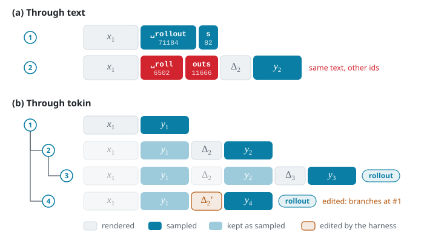

<aside class="post-aside">
<h3>Resources</h3>
<ul>
  <li><a href="https://github.com/open-rollout/tokin">open-rollout/tokin</a></li>
  <li><a href="https://github.com/open-rollout/tokin/tree/main/examples/pi_mimo_rl">examples/pi_mimo_rl</a></li>
</ul>
</aside>

TL;DR

Harnesses speak text. RL trains on sampled tokens. <strong>tokin</strong> is a gateway that makes any agent harness token-native: sitting between the harness and the inference engine, it ensures the model trains on exactly the tokens it sampled. It handles each rollout in a tree that grows with every request and records every harness event; every prefix in the tree stays token-in, token-out, so a request that continues from any earlier turn still builds on exactly what was sampled. With tokin and slime, we train Qwen3.8-27B and Qwen3.5-35B-A3B on MiMo-V2.6-RL with the pi coding agent kept as is, improving held-out MiMo pass@1 by +29.8 and +xx points and Terminal-Bench 2.1 by +3.1 and +xx points, respectively.

<figure>

<figcaption class="figcaption--numbered">Figure 1. Overview of tokin. Harnesses talk to tokin in text; the inference engine sees only tokens. Each session is a tree of turns, and each leaf of the tree is a rollout for training.</figcaption>
</figure>

## Harnesses speak text

A common framing today is `Agent = Model + Harness`. Harnesses such as Claude Code, Codex, pi, opencode and Terminus, simple or elaborate, define the interaction loop: when to send the conversation so far to the model, and how to act on its reply.

A harness, though, speaks text, and RL trains on tokens. Connect a harness straight to the inference engine and every turn makes a round trip: the model samples token ids $y$, the server decodes and parses them into a text message, the harness acts on it, and its next request sends back the whole conversation, which the server renders through the chat template and encodes again. Nothing makes this round trip return the ids the model sampled (Figure 2a), and the chat template may further drop past reasoning or re-serialise tool calls. Wherever an id changes, the trainer updates a token the policy never sampled, a harm illustrated repeatedly [<a href="#ref-1">1</a>, <a href="#ref-2">2</a>, <a href="#ref-3">3</a>].

## Gateway in between

tokin solves this for **any** harness. It is a gateway between harnesses and the inference engine (Figure 1), and it guarantees two properties. Write $m_k$ for the messages of request $k$, $x_k$ for the prompt ids tokin sends the engine for it, and $y_k$ for the ids the model samples back; ids are sequences over the vocabulary, and juxtaposition concatenates them.

Property 1 <em>(messages only)</em> A harness speaks only chat completions; token ids never cross to its side:

$$\text{harness} \xrightarrow{\;m_k\;} \text{tokin} \xrightarrow{\;x_k\;} \text{engine} \xrightarrow{\;y_k\;} \text{tokin} \xrightarrow{\;\mathrm{parse}(y_k)\;} \text{harness}.$$

A harness thus needs no change beyond its base URL, and tokin must recover all token state from $m_k$ alone. Request $k$ *continues* an earlier request $j$ when $m_k$ strictly extends $m_j\,\mathrm{parse}(y_j)$ and $y_j$ was not cut at the length limit, since a cut reply lacks the stop token that would close it. tokin attaches $k$ to a *parent*: the request it continues over the longest prefix of $m_k$, the latest on a tie; a request that continues none is a root. Usually the parent is the latest request, but a retry or an edit to history attaches to an earlier one.

Property 2 <em>(TITO at every prefix)</em> For every request $k$ with parent $j$,

$$x_k = x_j\, y_j\, \Delta_k,$$

where $\Delta_k$ encodes only the messages of $m_k$ past $m_j\,\mathrm{parse}(y_j)$. Hence $x_k$ begins with $x_i\, y_i$ for every ancestor $i$ of $k$.

The property holds by construction: tokin stores each request's $\Delta_k$ and $y_k$ and sends $x_k$ as the stored ids along the path to its parent followed by $\Delta_k$, so the only ids it ever encodes are each request's $\Delta_k$. The rollout that ends at a leaf $k$ is $x_k\, y_k$, every $y$ on its path exactly as sampled and every $\Delta$ masked from the loss. Since a parent need not be the latest request, the requests of a session form a tree (Figure 2b).

<figure>

<figcaption class="figcaption--numbered">Figure 2. (a) Through text, re-encoding changes the sampled ids. (b) Through tokin, each request extends the one it continues as sampled, and an edit to history branches off where it diverges: a session is a tree whose leaves are rollouts.</figcaption>
</figure>

## Inside the gateway

Each sample opens a **session** and hands the harness that session's base URL. From there the harness is an ordinary OpenAI client. For every request, tokin:

1. **attaches** it to its parent $j$ in the session;
2. **renders** only the messages new since request $j$, encodes them as $\Delta_k$, and sends $x_k = x_j\, y_j\, \Delta_k$;
3. **generates** on the engine from token ids to token ids, keeping what the trainer needs per position: logprobs, the sampler's top-p support, the experts each token was routed to, the weight version that sampled it;
4. **parses** the generation back into an assistant message, with its reasoning and tool calls, for the harness.

A session is a tree, not a list. Harnesses do not only append: pi compacts a long context into a summary and starts over from it, and resends a turn whose output ran out of length. A request that shares no path with any earlier turn starts a new root; one that edits or drops part of the conversation branches off where it diverged, keeping everything sampled before. Each leaf of the tree is one rollout: its token ids, a loss mask over the ids the model sampled, and their logprobs.

<!-- TODO: next section — does tokin change what the agent does? (the TITO A/B on Qwen3.6, 3 harnesses x 2 benchmarks) -->

## References

<ul class="references">
<li id="ref-1">[1] <em>No More Retokenization Drift: Returning Token IDs via the OpenAI Compatible API Matters in Agent RL.</em> <a href="https://vllm.ai/blog/2025-10-22-agent-lightning">vLLM blog</a>, 2025.</li>
<li id="ref-2">[2] Yuan He. <em>Strands-SGLang: Bridging Agent Scaffolding and RL Training.</em> <a href="https://yuanhe.wiki/posts/technical/strands-sglang/">yuanhe.wiki</a>, 2026.</li>
<li id="ref-3">[3] <em>Agentic RL: Token-In, Token-Out Done Right.</em> <a href="https://huggingface.co/blog/huggingface/tito">Hugging Face blog</a>, 2026.</li>
</ul>
