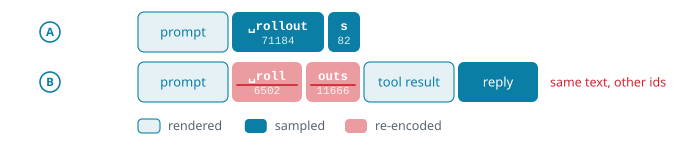
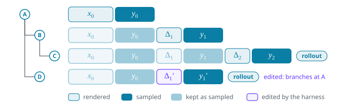
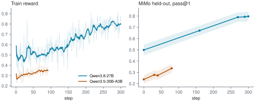

<aside class="post-aside">
<h3>Resources</h3>
<ul>
  <li><a href="https://github.com/open-rollout/tokin">open-rollout/tokin</a></li>
  <li><a href="https://github.com/open-rollout/tokin/tree/main/examples/pi_mimo_rl">examples/pi_mimo_rl</a></li>
  <li><a href="https://github.com/open-rollout/tokin/tree/main/examples/harbor_eval">examples/harbor_eval</a></li>
  <li><a href="https://pypi.org/project/tokin/">pip install tokin</a></li>
</ul>
</aside>

TL;DR

Harnesses speak text. RL trains on sampled tokens. <strong>tokin</strong> is a gateway that makes any agent harness token-native: sitting between the harness and the inference engine, it ensures the model trains on exactly the tokens it sampled. It keeps each session as a tree of the turns it served, and every path in the tree is token-in, token-out (TITO) at every prefix: a request that continues any earlier turn builds on exactly the ids that turn sampled. With tokin and slime, we train Qwen3.8-27B and Qwen3.5-35B-A3B on MiMo-V2.6-RL-oss with the pi coding agent, for improvements of +29.8 and +14.4 points on held-out MiMo pass@1 and +7.0 and +11.2 on Terminal-Bench 2.1, respectively.

<figure id="figure-1">

<figcaption class="figcaption--numbered">Figure 1. Overview of tokin. Harnesses talk to tokin in text; the inference engine sees only tokens. Each session is a tree of turns, and each leaf of the tree is a rollout for training.</figcaption>
</figure>

## Harnesses speak text

A common framing today is `Agent = Model + Harness`. Harnesses such as Claude Code, Codex, pi, opencode and Terminus, simple or elaborate, define the interaction loop: when to send the conversation so far to the model, and how to act on its reply.

A harness, though, speaks text, and RL trains on tokens.<a href="#n-modality">1</a>Note 1We consider text here. With images in the conversation, a harness still speaks messages rather than the model’s inputs, and what the model samples is still text tokens, so the same argument holds there. tokin v0.1.0 handles text only. Connect a harness straight to the inference engine and every turn makes a round trip: the model samples token ids $y$, the engine decodes and parses them into a text message, the harness acts on it, and its next request sends back the whole conversation, which the engine renders through the chat template and encodes again. Nothing makes this round trip return the ids the model sampled (<a href="#figure-2">Figure 2</a>), and the chat template may further drop past reasoning or re-serialize tool calls. Wherever an id changes, the trainer updates a token the policy never sampled, a harm discussed in [<a href="#ref-1">1</a>, <a href="#ref-2">2</a>, <a href="#ref-3">3</a>, <a href="#ref-4">4</a>].

<figure id="figure-2">

<figcaption class="figcaption--numbered">Figure 2. Through text, the next request re-encodes the sampled <code>␣rollout</code>·<code>s</code> as <code>␣roll</code>·<code>outs</code>: the same text, other ids.</figcaption>
</figure>

## A gateway with two properties

tokin solves this for **any** harness.<a href="#n-strands">2</a>Note 2<a href="#appendix-a">Appendix A</a> compares tokin with related projects. It is a gateway between harnesses and the inference engine (<a href="#figure-1">Figure 1</a>), and it guarantees two properties. For the request at turn $t$ of a trajectory (defined below), write $h_t$ for the history the harness sends, a list of messages; $x_t$ for the prompt ids tokin sends the engine; $y_t$ for the token ids the model samples back; $a_t$ for the assistant message tokin parses from them; and $o_t$ for the observation the request adds, such as tool results, or the task at $t = 0$. Juxtaposition concatenates sequences, ids and messages alike, e.g., $x_t\, y_t$ is $x_t$ followed by $y_t$.

Property 1 <em>(messages only)</em> A harness sees only messages ($h_t$, $a_t$); the token ids stay between tokin and the engine:

$$\text{harness} \xrightarrow{\;h_t\;} \text{tokin} \xrightarrow{\;x_t\;} \text{engine} \xrightarrow{\;y_t\;} \text{tokin} \xrightarrow{\;a_t\;} \text{harness} \xrightarrow{\;h_{t+1}\;} \cdots$$

A harness thus needs only a new base URL, and tokin recovers all token state from the history. A request *continues* an earlier one when its history is that request's history and reply, matched by text, reasoning and call ids, plus new messages, such as tool results, under the same tools; a reply cut at the length limit is never continued. tokin makes each request a child of the deepest request it continues, the latest on a tie, or a root if it continues none. Usually the parent is the latest request, but a retry or an edit to history attaches to an earlier one, so the requests of a session form a tree, or several after a compaction (<a href="#figure-3">Figure 3</a>). Each path from a root to a leaf is one trajectory, and $t$ counts turns within it:

$$h_t = h_{t-1}\, a_{t-1}\, o_t, \qquad h_0 = o_0.$$

Property 2 <em>(TITO at every prefix)</em> Along every trajectory, the ids extend as the messages do:

$$x_t = x_{t-1}\, y_{t-1}\, \Delta_t, \qquad x_0 = \Delta_0,$$

where $\Delta_t$ encodes what the chat template writes after $y_{t-1}$’s stop token: the rest of that turn’s end, $o_t$, and the opening of the next assistant turn; $\Delta_0$ is $o_0$ rendered with the tools, with the same opening. Hence $x_t$ begins with $x_s\, y_s$ for every $s < t$.

The property holds by construction: tokin stores each turn's $\Delta_t$ and $y_t$ and sends $x_t$ as the stored ids of turns $0$ to $t-1$ followed by $\Delta_t$, so the only ids it ever encodes are each turn's $\Delta_t$. A trajectory ending at turn $T$ is the rollout $x_T\, y_T$: every $y$ in it exactly as sampled and every $\Delta$ masked from the loss.

## Inside the gateway

<a href="#figure-1">Figure 1</a> follows one request through tokin. The trainer opens a **session** per sample with `POST /sessions` and hands the harness its base URL, `/sessions/{id}/v1`; from there the harness is an ordinary OpenAI client. For every request, tokin:

1. **attaches** it to its parent in the session, turn $t-1$ of its trajectory;
2. **renders** only the observation $o_t$, encodes it as $\Delta_t$, and sends $x_t = x_{t-1}\, y_{t-1}\, \Delta_t$;
3. **generates** on the engine from token ids to token ids, keeping each position's logprob and the weight version the engine reports for it and, when the trainer asks, the sampler's top-p support and the experts each token was routed to;
4. **parses** $y_t$ into the assistant message $a_t$, with its reasoning and tool calls, for the harness.

Take the session of <a href="#figure-3">Figure 3</a>. The harness first sends the task, $o_0$. Nothing precedes it, so request A is a root: tokin renders $o_0$ with the tools into $x_0 = \Delta_0$, the engine samples $y_0$, say a tool call, and the harness gets it back as $a_0$. The harness runs the tool and sends $h_1 = o_0\, a_0\, o_1$. Request B continues A, so tokin encodes only the tool result $o_1$ and sends $x_1 = x_0\, y_0\, \Delta_1$: the ids of $a_0$ are $y_0$ as sampled, not $a_0$ encoded again. Request C continues B the same way. Request D resends the conversation with $o_1$ rewritten as $o_1'$; it continues A but not B, so it branches at A and sends $x_1' = x_0\, y_0\, \Delta_1'$. A compaction, which many harnesses do (Claude Code, Codex, opencode, pi), replaces the history with a summary and starts a new root.

<figure id="figure-3">

<figcaption class="figcaption--numbered">Figure 3. A session’s tree. Each request extends the one it continues as sampled, and an edit to history branches off where it diverges; the leaves are rollouts.</figcaption>
</figure>

When the harness finishes, the trainer collects the session with `GET /sessions/{id}`, one safetensors payload that stores each turn once, however many rollouts share it. Here it holds two rollouts, C and D, sharing $x_0\, y_0$. `Session.collect` reads it back as a `Session`, whose `rollouts` each give `token_ids` ($x_T\, y_T$), a `loss_mask` that is 1 on every $y$ and 0 on every $\Delta$, and aligned `logprobs`; each turn keeps the rest of what step 3 returned.

## Training the pi coding agent with tokin

We train the [pi](https://pi.dev) coding agent on the code tasks of [MiMo-V2.6-RL-oss](https://huggingface.co/datasets/XiaomiMiMo/MiMo-V2.6-RL-oss), holding out 256 for validation,<a href="#n-tasks">3</a>Note 3Each task is a <a href="https://github.com/harbor-framework/harbor">Harbor</a> task, from <a href="https://huggingface.co/datasets/FineEnvs/MiMo-V2.6-RL-harbor-code">MiMo-V2.6-RL-harbor-code</a>, run in an E2B sandbox; the held-out tasks are listed in <a href="https://github.com/open-rollout/tokin/blob/main/examples/pi_mimo_rl/heldout.txt"><code>heldout.txt</code></a>. with [slime](https://github.com/THUDM/slime) [<a href="#ref-5">5</a>] in fully asynchronous mode as the trainer. [`examples/pi_mimo_rl`](https://github.com/open-rollout/tokin/tree/main/examples/pi_mimo_rl) has the recipe to reproduce it. Each trial runs pi on its own tokin session and is rewarded by the task's verifier. A session can yield several rollouts, one per leaf, and each becomes its own training sample. They share the session's **one reward** and count once in the group-mean advantage [<a href="#ref-6">6</a>]. Where they share a prefix, its sampled tokens are trained only **once**: the recipe sets their loss mask to 1 in the first rollout and 0 in the others.<a href="#n-shared">4</a>Note 4In 400 sessions sampled from the 27B run, 85% have one rollout; 14.5% split at compactions and 0.5% at a turn cut on length; none at a retry. The algorithm is REINFORCE [<a href="#ref-7">7</a>] with truncated importance sampling [<a href="#ref-8">8</a>], score centering [<a href="#ref-9">9</a>] and dynamic sampling [<a href="#ref-10">10</a>]. We train a dense model, Qwen3.8-27B, and an MoE model, Qwen3.5-35B-A3B, which also replays the sampler's expert routing in training (R3) [<a href="#ref-11">11</a>]; <a href="#table-1">Table 1</a> gives their settings.

| | Qwen3.8-27B | Qwen3.5-35B-A3B |
|---|---|---|
| reasoning | medium effort | thinking |
| batch per step | 8 tasks × 8 trials | 64 tasks × 16 trials |
| tokens per turn | 8,192 | 8,192 |
| steps | 300 (~1.0 epoch) | 200 (~5.2 epochs) |
| nodes, 8× H200 each | 3 training + 3 rollout | 3 training + 3 rollout |
| time per step | ~7 min | ~44 min |

Table 1. Training settings of the two models. The algorithm and the hyperparameters not listed are shared; parallelism and serving settings differ, and each launcher in <code>examples/pi_mimo_rl</code> holds them all. A trial is one pi run on one task; tokens per turn caps each generation. Epochs count the groups dynamic sampling keeps, against the 2,442 training tasks. Time per step is the median over training.

The train reward rises for both models (<a href="#figure-4">Figure 4</a>, left): from about 0.5 to 0.8 over Qwen3.8-27B's 300 steps, and from about 0.27 to 0.41 over Qwen3.5-35B-A3B's 200. Held-out MiMo pass@1, evaluated every 60 steps and every 10 near the end, rises with it, from 0.50 to 0.80 for the 27B model and from 0.24 to 0.38 for the 35B.

<figure id="figure-4">

<figcaption class="figcaption--numbered">Figure 4. Left: train reward per step (faint), the mean reward of the step’s trials before dynamic sampling, with its 10-step trailing mean. Right: held-out MiMo pass@1 with 95% CIs. Step 0 is the base model.</figcaption>
</figure>

We report each run's last checkpoint (<a href="#table-2">Table 2</a>).<a href="#n-update">6</a>Note 6Updated 2026-11-14: the 35B now reports step 200 (step 140 gave +13.5 and +5.1). Held-out MiMo measures generalization to unseen tasks from the training distribution; Terminal-Bench 2.1 (89 tasks) measures transfer beyond it. Both evaluations run pi with 4 samples per task and a per-turn limit of 32,768 tokens.<a href="#n-cap">5</a>Note 5Training caps a turn at 8,192 tokens to keep rollouts fast; evaluation allows 32,768 so the model's reasoning is not cut short.

| pass@1 | held-out MiMo | Terminal-Bench 2.1 |
|---|---|---|
| Qwen3.8-27B | 0.499 → **0.797** (+29.8) | 0.593 → **0.663** (+7.0) |
| Qwen3.5-35B-A3B | 0.238 → **0.382** (+14.4) | 0.368 → **0.480** (+11.2) |

Table 2. pass@1 of the base model and of each run’s last checkpoint, with the gain in points.

## tokin's release

We release tokin [v0.1.0](https://pypi.org/project/tokin/) as a beta: a harness keeps the API it already speaks, and every prefix of its rollouts stays exactly as sampled. The pi recipe above shows it at work, improving on held-out MiMo and on Terminal-Bench 2.1 for a dense and an MoE model (<a href="#table-2">Table 2</a>).

tokin has run more than pi. [`examples/harbor_eval`](https://github.com/open-rollout/tokin/tree/main/examples/harbor_eval) evaluates mini-swe-agent, opencode and pi through it on Terminal-Bench 2.1 and SWE-bench Verified. tokin currently covers the chat templates of Qwen2.5–Qwen3.8 and GLM-4.5–GLM-5.3, serves OpenAI's chat completions, and generates on SGLang. Next are the APIs other harnesses speak, such as OpenAI's Responses API for Codex and Anthropic's Messages API for Claude Code; each only translates requests and replies, and the rollout management behind them stays the same.

Community feedback is highly appreciated, and contributions are welcome, from a model family or a tool-call grammar to a harness API or a practical example. If you are interested, open an issue or a pull request on [open-rollout/tokin](https://github.com/open-rollout/tokin).

---

## References

<ul class="references">
<li id="ref-1">[1] The Agent Lightning (AGL) Team. <em>No More Retokenization Drift: Returning Token IDs via the OpenAI Compatible API Matters in Agent RL.</em> <a href="https://vllm.ai/blog/2025-10-22-agent-lightning">vLLM blog</a>, 2025.</li>
<li id="ref-2">[2] Yuan He and Chengxing Xie. <em>Strands-SGLang: Bridging Agent Scaffolding and RL Training.</em> <a href="https://yuanhe.wiki/posts/technical/strands-sglang/">yuanhe.wiki</a>, 2026.</li>
<li id="ref-3">[3] Quentin Gallouédec and Kashif Rasul. <em>Agentic RL: Token-In, Token-Out Done Right.</em> <a href="https://huggingface.co/blog/huggingface/tito">Hugging Face blog</a>, 2026.</li>
<li id="ref-4">[4] Miles Team (Jiajun Li et al.). <em>No Token Left Behind: Demystifying Token-In-Token-Out in Miles.</em> <a href="https://www.lmsys.org/blog/2026-05-13-no-token-left-behind">LMSYS blog</a>, 2026.</li>
<li id="ref-5">[5] Zilin Zhu, Chengxing Xie, Xin Lv and slime Contributors. <em>slime: An LLM post-training framework for RL Scaling.</em> <a href="https://github.com/THUDM/slime">github.com/THUDM/slime</a>, 2025.</li>
<li id="ref-6">[6] Zhihong Shao et al. <em>DeepSeekMath: Pushing the Limits of Mathematical Reasoning in Open Language Models.</em> <a href="https://arxiv.org/abs/2402.03300">arXiv:2402.03300</a>, 2024.</li>
<li id="ref-7">[7] Ronald J. Williams. <em>Simple Statistical Gradient-Following Algorithms for Connectionist Reinforcement Learning.</em> Machine Learning 8(3–4):229–256, 1992.</li>
<li id="ref-8">[8] Feng Yao et al. <em>On the Rollout-Training Mismatch in Modern RL Systems.</em> NeurIPS 2025 Workshop on Efficient Reasoning (<a href="https://openreview.net/forum?id=8MHqvb4lK9">OpenReview</a>); blog version: <em>Your Efficient RL Framework Secretly Brings You Off-Policy RL Training</em> (<a href="https://fengyao.notion.site/off-policy-rl">blog</a>), 2025.</li>
<li id="ref-9">[9] Martin Marek and Max Ryabinin. <em>Score Centering Stabilizes Off-policy Reinforcement Learning.</em> <a href="https://arxiv.org/abs/2609.20807">arXiv:2609.20807</a>, 2026.</li>
<li id="ref-10">[10] Qiying Yu et al. <em>DAPO: An Open-Source LLM Reinforcement Learning System at Scale.</em> <a href="https://arxiv.org/abs/2503.14476">arXiv:2503.14476</a>, 2025.</li>
<li id="ref-11">[11] Wenhan Ma et al. <em>Stabilizing MoE Reinforcement Learning by Aligning Training and Inference Routers.</em> <a href="https://arxiv.org/abs/2510.11370">arXiv:2510.11370</a>, 2025.</li>
<li id="ref-12">[12] Zhiyuan He et al. <em>Agent Lightning v1.0: Towards Harnessed Agentic RL.</em> <a href="https://arxiv.org/abs/2608.17528">arXiv:2608.17528</a>, 2026.</li>
</ul>

## Appendix

### A. tokin compared with related projects {#appendix-a}

Several open projects also record the token ids of an agent's turns. <a href="#table-3">Table 3</a> compares tokin with three of them: [Agent Lightning](https://github.com/microsoft/agent-lightning) [<a href="#ref-1">1</a>], [strands-sglang](https://github.com/open-rollout/strands-sglang) [<a href="#ref-2">2</a>] and [Miles](https://github.com/radixark/miles) [<a href="#ref-4">4</a>].<a href="#n-related">7</a>Note 7Read at Agent Lightning <a href="https://github.com/microsoft/agent-lightning/tree/bc3a9e8">bc3a9e8</a>, strands-sglang <a href="https://github.com/open-rollout/strands-sglang/tree/dda03af">dda03af</a> and Miles <a href="https://github.com/radixark/miles/tree/2f627e0">2f627e0</a>.

| | Agent Lightning | strands-sglang | Miles | tokin |
|---|:-:|:-:|:-:|:-:|
| any harness | ● | ○ | ● | ● |
| TITO at every prefix | ○ | ◐ | ◐ | ● |
| tree of turns | ○ | ○ | ◐ | ● |
| any trainer | ◐ | ● | ◐ | ● |

Table 3. tokin and related projects: ● yes, ◐ in part, ○ no.

- **Any harness.** strands-sglang serves only agents built on Strands Agents; the other three serve harnesses over HTTP.
- **TITO at every prefix.** Agent Lightning has vLLM re-render each chat request and joins calls into one sample only where the ids happen to match; only an agent that tokenizes for itself and sends ids to `/v1/completions` keeps the sampled ids.<a href="#n-agl">8</a>Note 8By design [<a href="#ref-12">12</a>], Agent Lightning matches a plain deployment, so it starts a new sample wherever TITO breaks. tokin keeps TITO throughout, and <a href="#appendix-b">Appendix B</a> finds that doing so has no measurable effect on eval. strands-sglang holds TITO only while the history grows, and Miles at any earlier prefix only in its experimental v2.
- **Tree of turns.** When the harness retries a turn, Agent Lightning keeps only the last attempt; when the harness edits or compacts its history, Agent Lightning starts a new sample. strands-sglang raises on a shorter history and, after an edit, still sends the old ids. Miles keeps a tree in its experimental v2.
- **Any trainer.** Agent Lightning ships only verl, though it exports each call's ids over HTTP. Miles launches its session server from its own training arguments and trains on its samples, though the server exports them over HTTP.

### B. tokin has no measurable effect on evaluation {#appendix-b}

With tokin, later turns see the sampled ids rather than their re-encoding. To check whether that changes evaluation with the policy frozen, we ran Qwen3.6-35B-A3B with mini-swe-agent, opencode and pi on Terminal-Bench 2.1 (89 tasks × 4 samples) and SWE-bench Verified (500 tasks × 1 sample), once through tokin and once through the same gateway re-rendering every turn from text. Over the 2,568 paired samples, pass@1 through tokin minus re-rendering is +0.1 points (95% CI [−1.5, +1.7]).
